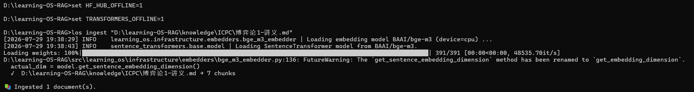

# 使用指南

## 系统指令

帮助 \
los --help \
加入文件 \
los ingest "文件目录" \
检查系统状态 \
los stats
检索（不需要LLM）\
los search "Nim游戏的必胜策略" \
问答（需要LLM）\
los ask "Nim游戏的必胜策略" \

## 配置

### dockers

Qdrant 是一个向量搜索引擎

```bash
docker run -d -p 6333:6333 -p 6334:6334 --name qdrant qdrant/qdrant
```

### 向量模型

首次启动会自动下载模型，下载完成后开启离线模式
```bash
set HF_HUB_OFFLINE=1
set TRANSFORMERS_OFFLINE=1
```



## 启动
先启动docker
```bash
streamlit run web/app.py
```

